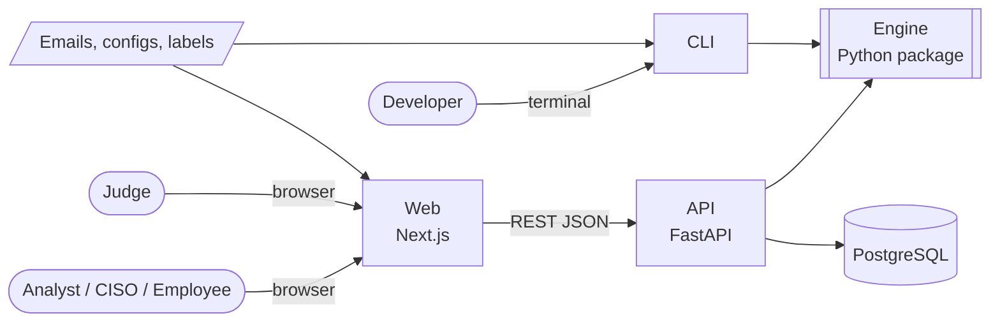
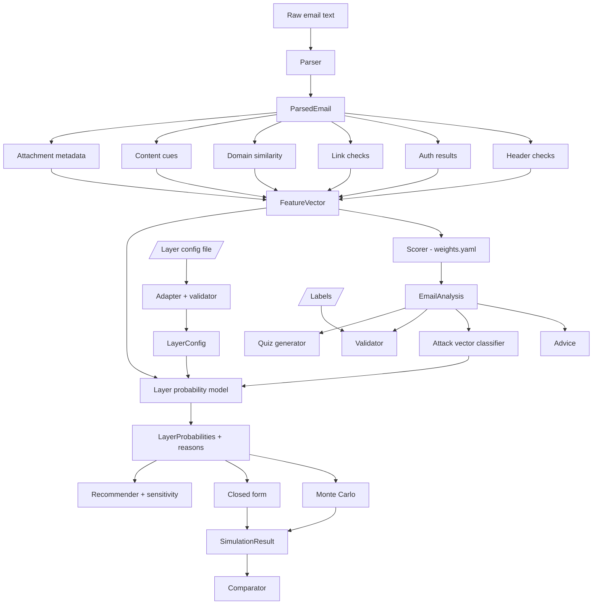
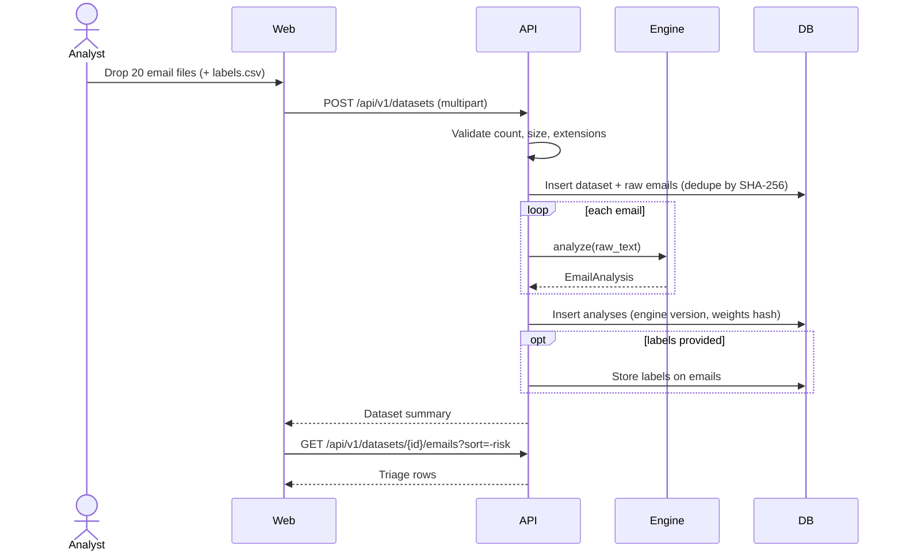
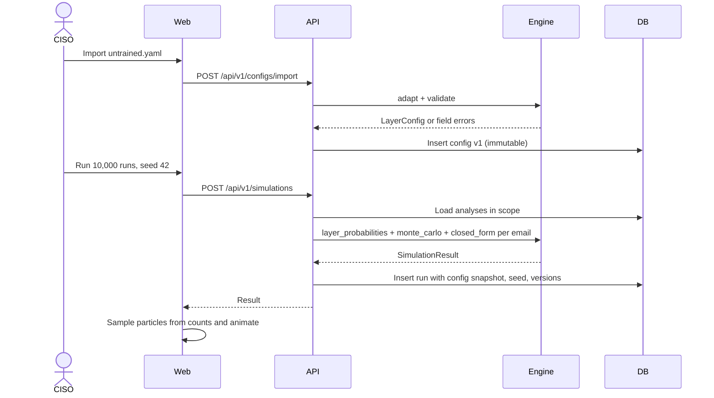
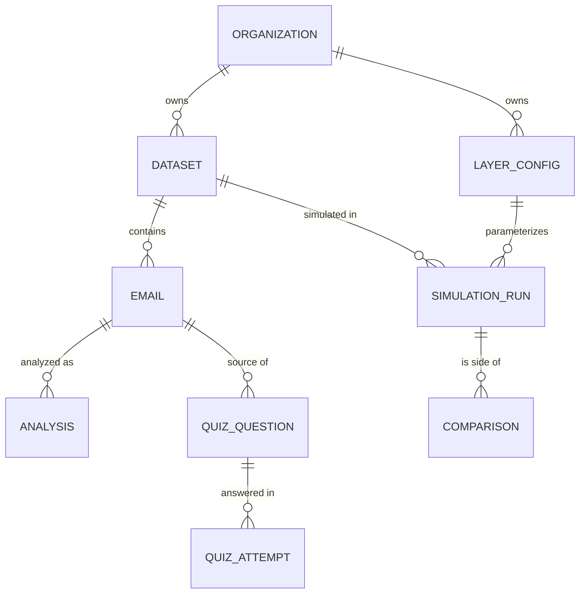

# Architecture

How LayerSight is structured and how data flows. Algorithms and code-level detail are in `engineering.md`.

## 1. Drivers

| Driver | Consequence |
|---|---|
| Correctness and reproducibility | Pure, deterministic engine; seeded simulations; versions on every result |
| Explainability | Evidence and per-layer reasons are first-class data |
| Demo reliability | Offline, seeded demo dataset, fast synchronous endpoints |
| Parallel building | Frozen contracts (Pydantic → OpenAPI → TypeScript) |
| Path to SaaS | Organization-scoped data model, stateless API |

## 2. System context



No external services. The engine reads only what it is given.

## 3. Containers

| Container | Tech | Responsibility | Does not |
|---|---|---|---|
| Web | Next.js, TypeScript, Tailwind, shadcn/ui, ECharts, D3, Motion | Rendering, upload, config editing, animation | Compute metrics |
| API | FastAPI, Pydantic v2, SQLAlchemy 2 | HTTP surface, persistence, orchestration, exports | Contain analysis or simulation logic |
| Engine | Python 3.12, NumPy, BeautifulSoup, RapidFuzz, tldextract | Parsing, features, scoring, advice, similarity, simulation, comparison, recommendations, validation, quiz | Import web or DB code; use the network |
| CLI | Typer + Rich | Reproduce core-target results in a terminal | Need the database |
| Database | PostgreSQL 16 (SQLite fallback) | Datasets, emails, analyses, configs, runs, quiz attempts | Be required by the engine |

## 4. Engine components



| Package | Input | Output |
|---|---|---|
| `parsing` | raw text | `ParsedEmail` |
| `features` | `ParsedEmail`, reference data | `FeatureVector` (flat named features) and findings |
| `scoring` | findings, weights | `EmailAnalysis` (score, band, label, evidence, advice) |
| `simulation.vectors` | `EmailAnalysis` | `AttackVector` + reason |
| `config` | YAML/JSON | validated `LayerConfig` |
| `simulation.model` | analysis, config, assumptions | `LayerProbabilities` |
| `simulation.montecarlo` / `analytic` | probabilities, runs, seed | counts, rates, intervals |
| `simulation.compare` | two configs, emails, seed | `ComparisonResult` |
| `simulation.recommend` | config, emails, catalog | ranked `Recommendation[]`, sensitivity |
| `validation` | analyses, labels | `ValidationReport` |
| `quiz` | analyses | `QuizQuestion[]` |

All functions are pure. Randomness enters only through an explicit `numpy.random.Generator`.

## 5. Key flows

### F1. Ingest and analyze



Labels are stored but never passed to `analyze`.

### F2. Investigate
`GET /api/v1/emails/{id}` returns headers, auth, links, attachments, sanitized body, evidence, advice, vector and a cached before/after comparison for the active config pair. The page renders from one response.

### F3. Configure and simulate



### F4. Compare
`POST /api/v1/comparisons {dataset_id, config_a, config_b, runs, seed}`. One uniform random matrix per email (seeded from global seed + email hash) is evaluated against both configs, so the difference reflects only the config change. Returns both results, absolute and relative reduction, per-layer and per-email deltas, a config diff and the narrative sentence.

### F5. What-if and recommendations
- Dragging a Defense slider triggers a debounced (~150 ms) `POST /api/v1/simulations` with an inline unsaved config and `persist: false`.
- `POST /api/v1/recommendations` evaluates an intervention catalog with the closed form (exact, no noise), ranks by reduction in aggregate pass-through, and returns per-layer sensitivity.

### F6. Quiz
`GET /api/v1/datasets/{id}/quiz?n=10` builds questions from analyses. `POST /api/v1/quiz/attempts` records answers. Stretch: quiz accuracy offered as the user-layer catch rate in Defense.

### F7. Validation and export
`GET /api/v1/datasets/{id}/validation` computes metrics from stored analyses and labels. `report.json` / `report.csv` include config snapshots, seeds, engine version and weights hash. PDF = Reports page with a print stylesheet.

### F8. Demo bootstrap
`make demo` (or `DEMO_MODE=true`) seeds the official emails, labels and both configs, runs analyses and the comparison, and caches results. `POST /api/v1/demo/reset` restores that state. The demo never depends on a live upload succeeding.

## 6. Data architecture



| Table | Key columns | Notes |
|---|---|---|
| `organization` | id, name | One default row for now |
| `dataset` | id, org_id, name, source, created_at | Official, dev, uploads |
| `email` | id, dataset_id, filename, sha256, raw_text, label (nullable) | Raw kept for re-analysis |
| `analysis` | id, email_id, engine_version, weights_hash, risk_score, label, band, attack_vector, parsed, features, evidence, advice (JSONB) | Append-only |
| `layer_config` | id, org_id, name, version, body (JSONB), source_filename | Immutable; edits create versions |
| `simulation_run` | id, dataset_id, config_id (nullable), config_snapshot, runs, seed, engine_version, results (JSONB) | Snapshot makes runs reproducible |
| `comparison` | id, run_a_id, run_b_id, summary (JSONB) | |
| `quiz_question` | id, email_id, kind, prompt, options, answer, explanation | |
| `quiz_attempt` | id, question_id, participant, chosen, correct, created_at | |

JSONB for analysis and simulation payloads because their shapes change quickly and they're always read whole. Pydantic enforces their schema.

## 7. API design

- REST, JSON, prefix `/api/v1`. FastAPI's OpenAPI is the frontend contract.
- Errors: RFC 7807 `application/problem+json` with field details for config validation.
- Synchronous; nothing at this scale takes over a second.
- Responses with numbers carry `engine_version`; simulations also carry `seed` and `runs`.

## 8. Frontend architecture

```
app/
  layout.tsx            shell: nav, dataset + config-pair selectors, assumptions drawer
  page.tsx              01 Command Center
  triage/page.tsx       02 Triage
  triage/[id]/page.tsx  03 Investigation
  intelligence/page.tsx 04 Intelligence
  defense/page.tsx      05 Defense
  simulator/page.tsx    06 Simulator
  compare/page.tsx      07 Compare
  academy/page.tsx      08 Academy
  reports/page.tsx      09 Reports
```

| State | Where | Examples |
|---|---|---|
| Server | TanStack Query keyed by dataset and config | emails, analyses, results |
| Draft UI | Zustand | unsaved config edits, quiz progress |
| Shareable | URL params | triage filters, compared configs, seed |

## 9. Deployment

**Local / demo (primary):** `docker compose up` runs `db` (Postgres 16), `api` (uvicorn :8000), `web` (Next.js :3000). `make demo` seeds. Works offline once dependencies are installed; tldextract uses a bundled suffix list and fonts are self-hosted.

**Hosted (optional):** web on Vercel; API and Postgres on Railway or Fly.io. The local run stays the demo of record.

## 10. Cross-cutting concerns

- **Security:** API returns sanitized text and defanged URLs (`hxxps://micros0ft[.]com`); UI never injects email HTML; no URL is fetched; upload and zip limits with path-traversal checks.
- **Determinism:** per-email seeds from global seed + SHA-256, so file order doesn't change results.
- **Versioning:** `engine_version` and `weights_hash` (weights + assumptions) on every analysis and run.
- **Observability:** structured JSON logs with request id and timings; no email content in logs.
- **Configuration:** `pydantic-settings` (`DATABASE_URL`, `DEMO_MODE`, `CORS_ORIGINS`).

## 11. Path to SaaS

| Need | Change |
|---|---|
| Multi-tenant | `org_id` already everywhere; add row-level security and OIDC SSO |
| Large volumes | Background workers (Arq or Celery) with progress streaming |
| Integrations | Ingestion service for Microsoft Graph and Gmail writing into `email` |
| Calibration | Store observed outcomes; fit layer rates per organization |
| More layers | Layers are a list in the schema and matrix; adding MFA is data, not new architecture |

## 12. Architecture decisions

| ADR | Decision | Why | Trade-off |
|---|---|---|---|
| 001 | Standalone engine package with CLI | Testable, reproducible core target without UI | Extra package boundary |
| 002 | Explainable weighted rules, not ML | 20 emails can't train a model; evidence required | Careful tuning on a dev set |
| 003 | Monte Carlo plus closed-form check | Stop distribution for charts; provable correctness | Two paths, tested together |
| 004 | Email-specific layer probabilities | Ties detection to simulation; meets the brief | More assumptions to expose |
| 005 | Common random numbers in comparisons | Differences reflect config, not noise | None meaningful |
| 006 | Offline, no enrichment | Determinism, safety, reliability | No domain-age or reputation signals |
| 007 | Backend is the only source of numbers | One truth across CLI, API, UI | What-if needs a fast round trip |
| 008 | OpenAPI-generated TS types | Contract drift caught at compile time | Regenerate on change |
| 009 | Synchronous endpoints | Milliseconds at this scale | Revisit for SaaS |
| 010 | JSONB result payloads | Fast iteration | Schema enforced in Pydantic, not DB |
