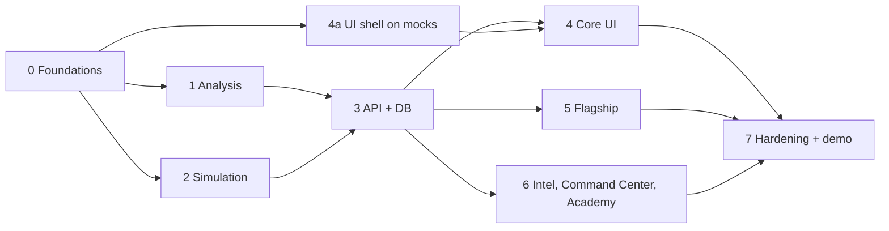

# Phases

The build in phases, each with a goal, tasks and an exit criterion. People and timing are in `plan.md`.

**Priority:** P0 = core target or demo; P1 = what wins; P2 = stretch.

## Overview

| Phase | Name | Priority | Depends on |
|---|---|---|---|
| 0 | Foundations and contracts | P0 | — |
| 1 | Analysis engine | P0 | 0 |
| 2 | Simulation engine | P0 | 0 (stubs phase 1 outputs) |
| 3 | API and persistence | P0 | 1, 2 |
| 4 | Core UI: Triage, Investigation, Reports | P0 | 3 (4a shell on mocks after 0) |
| 5 | Flagship: Defense, Simulator, Compare | P0/P1 | 2, 3 |
| 6 | Intelligence, Command Center, Academy | P1/P2 | 1, 3 |
| 7 | Hardening and demo | P0 | all |

**Critical path:** 0 → 1 → 3 → 4 → 7. The core target is reachable from the CLI at the end of phases 1 and 2, before any UI.

## Phase 0: Foundations and contracts (P0)

**Goal:** everyone works in parallel against frozen interfaces.

- [ ] Monorepo (`engine/`, `api/`, `web/`, `data/`), uv, pnpm, Makefile, docker compose with Postgres 16, `.gitignore`.
- [ ] Git setup from `github.md` §3 on every machine (identity, hooks).
- [ ] Pydantic contracts v1 in `engine/layersight/models.py`.
- [ ] Inspect official data; record format in `context.md` §10; copy unchanged to `data/test/`.
- [ ] `data/dev/`: ≥ 30 labeled emails covering every rule, hard negatives and hard positives; two canonical configs.
- [ ] Reference data: brands, free-mail, shorteners, TLDs, homoglyphs, bundled suffix list.
- [ ] Mock JSON for every contract.
- [ ] Web: Next.js, tokens, fonts, shadcn/ui, app shell with the eight-item nav.
- [ ] CI: ruff, mypy, pytest, ESLint, typecheck.

**Exit:** `make dev` starts everything; contracts merged; both datasets present.

## Phase 1: Analysis engine (P0)

**Goal:** classify correctly and explain why.

- [ ] Tolerant parser (RFC 5322, MIME, simplified text), attachment metadata, auth results.
- [ ] Link extraction from HTML and text.
- [ ] Registrable-domain utilities (offline tldextract, IDN).
- [ ] Domain similarity v1 (homoglyph, TLD swap, subdomain abuse, combosquat, typosquat).
- [ ] Rules H01–H04, A01–A04, L01–L09, C01–C05, T01–T05, G01–G02 with positive and negative tests.
- [ ] Scorer, bands, evidence contributions, weights hash.
- [ ] Advice templates.
- [ ] Attack vector classifier with reasons.
- [ ] CLI `analyze`, `validate`, `similarity`.
- [ ] Tune on dev → evaluate on test → error analysis → iterate on dev.

**Exit:** ≥ 18/20 on `data/test`; every evidence item has a plain-language explanation; validation gate in CI.

## Phase 2: Simulation engine (P0)

**Goal:** email-specific, vector-aware pass-through for any config, and comparisons.

- [ ] Canonical config schema with clear validation messages.
- [ ] Adapter for the official config format; both files load.
- [ ] `assumptions.yaml`.
- [ ] Filter-rule DSL and matcher.
- [ ] Layer probability model with reasons and applicability matrix.
- [ ] Vectorized Monte Carlo, per-email seeding, closed form, Wilson interval, aggregate.
- [ ] Comparison with common random numbers, config diff, narrative.
- [ ] Golden and property tests.
- [ ] CLI `simulate`, `compare`.

**Exit:** CLI prints per-email and aggregate pass-through for both official configs; MC inside the interval for every email; golden test passes. **Core target met.**

## Phase 3: API and persistence (P0)

**Goal:** everything the UI needs over HTTP, stored and reproducible.

- [ ] FastAPI app, settings, CORS, problem+json errors.
- [ ] SQLAlchemy models and first migration.
- [ ] Services and all routers from `engineering.md` §19.
- [ ] Multipart and zip upload with limits.
- [ ] Seed command, `DEMO_MODE`, `/demo/reset`.
- [ ] `make types` generates TS types.
- [ ] API tests.

**Exit:** upload → analyze → import configs → simulate → compare → validation all work from the API docs page.

## Phase 4: Core UI (P0)

**Goal:** demo beats 1, 2 and 5 in the browser. 4a (shell and components on mocks) starts right after phase 0.

- [ ] Top bar: dataset, config pair, assumptions drawer.
- [ ] Components: RiskScore, band badge, AuthBadge, EvidenceItem, DomainDiff, empty/loading/error states.
- [ ] 02 Triage: dropzone, tabs with counts, search, sort, table, row → investigation.
- [ ] 03 Investigation: verdict, headers with mismatch highlights, auth badges, evidence breakdown, links, attachments, sanitized body, advice, before/after outlook.
- [ ] 09 Reports: KPIs, confusion matrix, metrics, per-email table, misclassifications, reproducibility footer, JSON/CSV export, print stylesheet.
- [ ] Replace mocks with the generated client.

**Exit:** a new user uploads 20 emails, understands any verdict, sees ≥ 18/20 on Reports.

## Phase 5: Flagship screens (P0/P1)

**Goal:** demo beats 3 and 4.

- [ ] 05 Defense: five layer cards, rules editor, training control, sliders, matrix, versions, import/export, live preview.
- [ ] 06 Simulator: controls, attack flow from real results, funnel, donut with interval and closed form, per-vector and per-email bars.
- [ ] 07 Compare: result cards, relative reduction, narrative, config diff, layer deltas, per-email table.
- [ ] What-if debounced simulations (P1).
- [ ] Recommendations and sensitivity tornado (P1).

**Exit:** UI numbers equal CLI numbers for the same seed; training change updates residual risk in under 250 ms; comparison sentence correct for the official configs.

## Phase 6: Intelligence, Command Center, Academy (P1/P2)

**Goal:** all nine screens on real data.

- [ ] 04 Intelligence (P1): design first; domains table, techniques, diff, deceptive links, checker.
- [ ] 01 Command Center (P1): KPIs, donut, before/after, funnel, top recommendation, top threats, brands.
- [ ] 08 Academy (P2): generator, endpoints, quiz UI with feedback and score.
- [ ] Quiz accuracy as user-layer rate (P2).
- [ ] Uncertainty bands (P2).

**Exit:** every nav item opens a working, API-backed screen.

## Phase 7: Hardening and demo (P0)

**Goal:** a demo that can't fail.

- [x] Playwright spec for the exact demo path.
- [x] Demo mode verified with Wi-Fi off.
- [x] States everywhere; zero console errors.
- [x] Performance check.
- [x] README: one-command setup, CLI fallback, assumptions, doc links.
- [x] Backup video.
- [x] Three timed rehearsals.

**Exit:** two consecutive clean rehearsals under 3:00; fresh clone to running demo in under 10 minutes.

## Cut line

Cut from the top first:

1. Server-side PDF (keep print stylesheet)
2. Uncertainty bands
3. Quiz accuracy feeding the simulator
4. Academy
5. Command Center polish (keep KPIs)
6. Standalone Intelligence screen (keep similarity in Investigation)
7. Attack flow animation (keep static funnel)
8. Live what-if sliders (keep Save and Run)

**Never cut:** classification with evidence, validation with confusion matrix, both configs' pass-through, the where-attacks-stop chart, the comparison, the CLI fallback.
